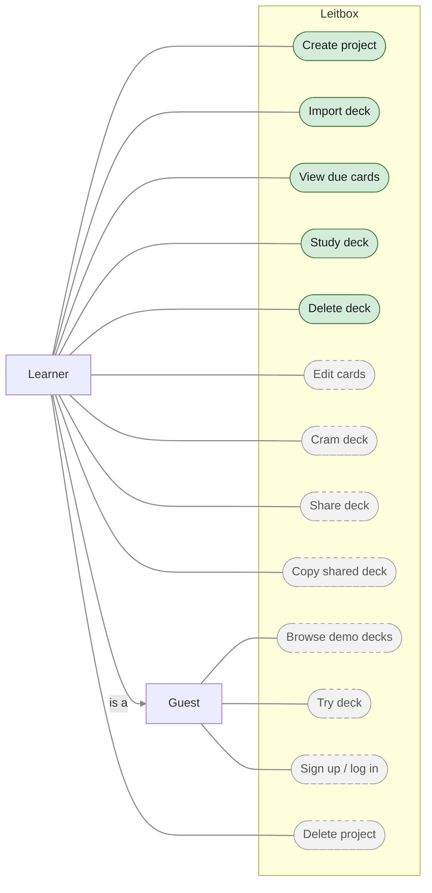

# 1. Use cases

Who uses Leitbox, and for which goals. Green use cases are part of the **MVP**;
grey dashed ones come **after the MVP** (already designed, not built in the MVP).

## Explanation

**Actors.** The **Learner** studies their own material: creates projects, imports decks from
CSV files and studies them. The **Guest** is a visitor without an account (for example on the
hosted app): they can browse the demo decks, try one, and sign up or log in. The arrow means
a learner **is a** guest with more rights: everything a guest can do, a learner can do too
(e.g. try a demo deck before copying it).

**MVP (Phase 1, CLI).** One learner, no accounts:
- **Create project** — a topic such as "German"; every deck belongs to one.
- **Import deck** — from a CSV file, all or nothing; new cards start in box 1, due today.
- **View due cards** — how many cards are due in each deck.
- **Study deck** — the deck's due cards one by one; the learner reveals the answer and says
  whether they knew it. Moving the card between boxes and scheduling the next review are
  steps *inside* this use case, done by the system, so they are not separate use cases.
- **Delete deck** — removes a deck and its cards after a warning, e.g. to re-import a
  corrected file. Recorded reviews are kept for statistics.

**After MVP.**
- **Edit cards** — fix, add or delete single cards without losing progress.
- **Cram deck** — go through a whole deck without changing boxes or due dates.
- **Share deck / Copy shared deck** — share a deck by a link; save a deck shared with you
  (or a demo deck) into your own project. The copy is independent.
- **Browse demo decks / Try deck** — look at the public reference decks and study one
  *without saving progress*; the guest is told this before starting.
- **Sign up / log in** — becoming a learner with an account.
- **Delete project** — removes a project with all its decks, after a warning.

Details and acceptance criteria: [requirements](../requirements.md) §5–§6.

> Mermaid has no use-case diagram type, so this is a flowchart: actors on the left, use cases
> as rounded shapes inside the system boundary. In standard UML the generalisation arrow has a
> hollow triangle head.
