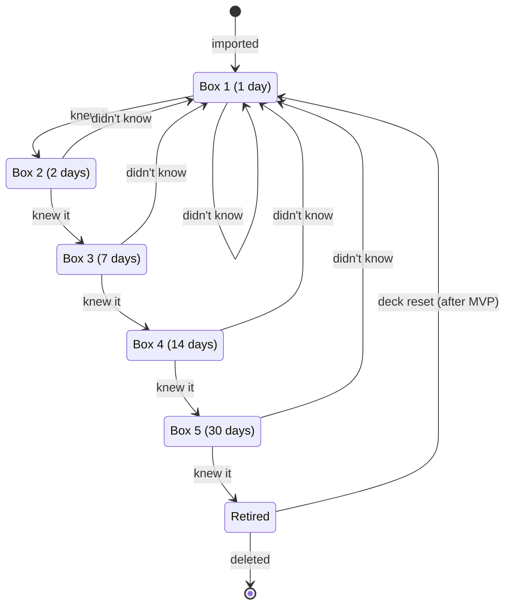

# 2. Card lifecycle

The states one card goes through, and which answer moves it where. This is the Leitner
scheduling from the [requirements](../requirements.md) §4 (R2–R5) as a state machine.

## Explanation

**States.** A card is in one of the five **boxes** while it's being learned, or **retired**
once it's learned. The box decides when the card is due next: the date of the answer plus the
box's interval (in brackets). A newly imported card starts in box 1 and is due the same day.

**Events.** The learner's self-assessment after revealing the answer: **knew it** moves the
card up one box; **didn't know** sends it back to box 1, due the next day, from any box.
Knowing it in box 5 retires the card. So a card is retired after five correct answers in a
row, spread over at least 54 days.

**State × event table** (the check that the rules have no holes):

| State | knew it | didn't know | deleted *(after MVP)* |
|---|---|---|---|
| Box 1 | → Box 2 | → Box 1 | → end |
| Box 2 | → Box 3 | → Box 1 | → end |
| Box 3 | → Box 4 | → Box 1 | → end |
| Box 4 | → Box 5 | → Box 1 | → end |
| Box 5 | → Retired | → Box 1 | → end |
| Retired | not allowed (not in study sessions) | not allowed | → end |

After the MVP, a **deck reset** sends every card of a deck, retired ones included, back to box 1,
due the same day: the deck is learned again from the start. A single retired card can't be
brought back on its own.

**Not shown, to keep the diagram readable:**
- **Deleting** a card (or its deck) ends its life from *any* state, not only from Retired.
- A **deck reset** also moves cards in boxes 2–5 back to box 1; only the arrow from Retired is drawn.
- **Cram mode** goes through all cards of a deck, retired ones included, without changing
  any state, so it has no arrows.
- **Overdue** is not a state: it's calculated from the due date.

**Design note.** An earlier version needed two correct answers in box 5 before retiring.
Drawing this diagram showed that the required counter was really a hidden extra state
("box 5, answered once"). It was removed: every box now follows the same two rules, and the
model needs no counter.
