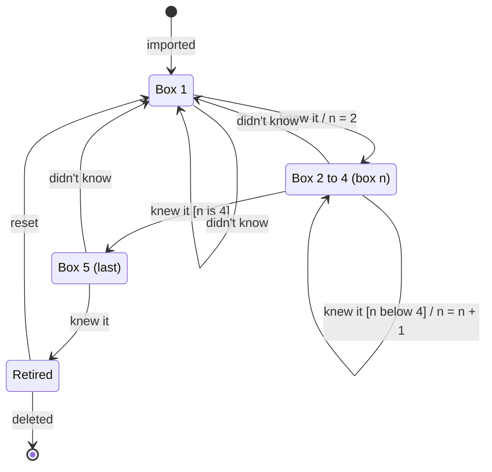

# 2. Card lifecycle

The states one card goes through, and which answer moves it where. This is the Leitner
scheduling from the [requirements](../requirements.md) §4 (R2–R5) as a state machine.

## Explanation

A card is **active** while it's in one of the boxes, and **retired** once it's learned.
Labels read `event [condition] / what changes`. Boxes 2–4 behave the same, so they're drawn
as one state with the box number `n`.

- **Imported:** the card starts in box 1, due the same day.
- **Knew it:** the card moves up one box; in the last box it's retired instead.
- **Didn't know:** the card goes back to box 1, due the next day, from any box.
- **Reset** (after the MVP): a deck reset sends the deck's cards back to box 1.
- After each answer the card is due again after its new box's interval:

| Box | 1 | 2 | 3 | 4 | 5 (last) |
|---|---|---|---|---|---|
| Due again after | 1 day | 2 days | 7 days | 14 days | 30 days |

So a card is retired after five correct answers in a row, spread over at least 54 days. The
diagram shows the default of 5 boxes; the number of boxes and the intervals are configuration
(N3), and the rules stay the same.

**State × event table** (every combination has an answer, so the rules have no holes):

| State | knew it | didn't know | deleted |
|---|---|---|---|
| Box 1 | → Box 2 | → Box 1 | → end |
| Box 2–4 | → next box (box 5 after box 4) | → Box 1 | → end |
| Box 5 | → Retired | → Box 1 | → end |
| Retired | not allowed (not in study sessions) | not allowed | → end |

**Not shown:**
- **Deleting** a card (or its deck) ends its life from any state; only the arrow from
  Retired is drawn.
- **Deck reset** also sends active cards back to box 1; only the arrow from Retired is drawn.
- **Cram mode** changes nothing, so it has no arrows. **Overdue** is calculated from the due
  date; it's not a state.
