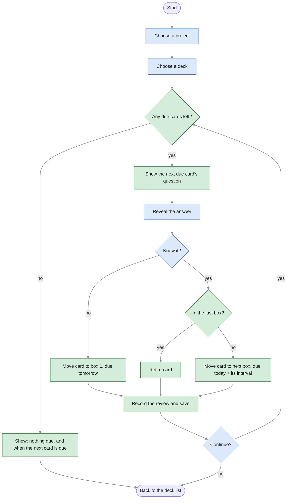

# 3. Review flow

What happens in one study session, from choosing a deck until the learner is done. Blue steps
are done by the **learner**, green steps by the **system**.

## Explanation

**Before the first card.** The learner chooses a project and one of its decks: a session
always covers one deck. If nothing in the deck is due, the learner sees a message with the
date of the next due card and goes back to the deck list.

**For each card** (the loop):
1. The system shows the **question** of the next due card. The order is fixed: oldest due
   date first, then lower box, then import order (R8).
2. The learner **reveals the answer** and says whether they **knew it** (self-assessment, R1).
3. The system applies the Leitner rules (R3–R6), the same ones as in the
   [card lifecycle](02-card-states.md): *didn't know* → box 1, due tomorrow; *knew it* → the
   next box, due after that box's interval, or **retired** if the card was in the last box.
4. The review is **recorded** (R12) and **saved immediately**, before the next card is shown,
   so no answer is lost if the app stops (N1).
5. The learner continues or stops.

**Ending.** The session ends when no due cards are left or when the learner stops; either
way the learner is back at the deck list. Cards not reviewed stay due (R11). A learner can
also quit while a question is shown: that card wasn't answered, so it stays due as well.

**Each card at most once per session.** A card answered "didn't know" is due tomorrow, so it
doesn't come back in the same session (R16).
