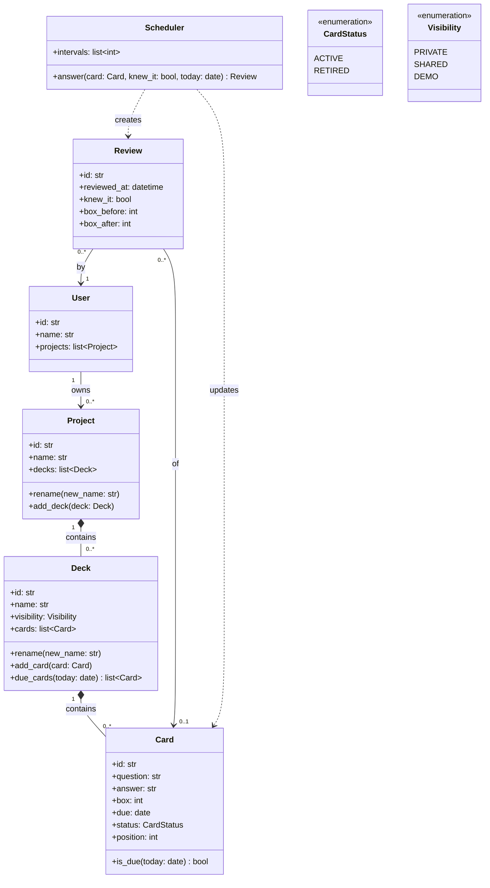

# 4. Domain model

The classes of the Leitbox core: what each one knows (attributes), what it does (methods),
and how they're related. This is the **domain** only: no files, database or user interface
(see [requirements](../requirements.md) N8). It lives in the `domain/` package of the
[architecture](05-architecture.md).

## Explanation

**Ownership.** A **user** owns projects; a **project** contains decks; a **deck** contains
cards. Each deck belongs to exactly one project and each card to exactly one deck (R13). The
filled diamond (composition) means the parts don't live on their own: deleting a project
deletes its decks, and deleting a deck deletes its cards, after a warning (R17). In the MVP there is a single default user, but every project already has
an owner, so accounts can be added after the MVP without changing the model.

**Card.** Holds the question and answer, its Leitner **box** (1–5), its **due** date and its
**status** (active or retired). A retired card keeps `box = 5`, the box it retired from.
`position` is the card's place in the imported file; it's the last tie-breaker in the study
order (R8). `is_due(today)` answers "should this card be studied on this day?" (R10).

**Deck.** `due_cards(today)` returns the deck's active cards that are due, in study order:
oldest due date, then lower box, then position (R7, R8). The deck can do this because it has
the cards (the class that has the data does the work). `visibility` is private in the MVP;
shared and demo are used after the MVP (R14).

**Scheduler.** Applies the Leitner rules (R3–R6). It's created with the intervals from the
configuration (one per box, so the number of boxes is the length of the list). Its `answer`
method takes a card, the learner's self-assessment and today's date, moves the card to its new
box (or retires it), sets the new due date, and returns a **Review**. The rules live here and
not in `Card`, so the intervals stay in one place and new card types don't change the rules.

**Review.** The record of one answer (R12): when, the result, and the box before and after.
It doesn't change anything itself; it's written after the card has changed, and it's the data
that statistics will be built from after the MVP. Reviews are **kept when their card is
deleted** (R18), so statistics don't change after the fact: that's why a review points to
`0..1` cards (the card may be gone) and directly to its user (the path through card, deck and
project may no longer exist).

**After the MVP** these are added without changing the classes above: `Deck.copy_to(project)`
and sharing (R14, R15), editing and deleting single cards (US-12), resetting a deck (US-11), deleting a project (US-13),
a timezone on `User` (N2).

`today` is always passed in, never read from the clock inside the core, so tests can choose
any date.
