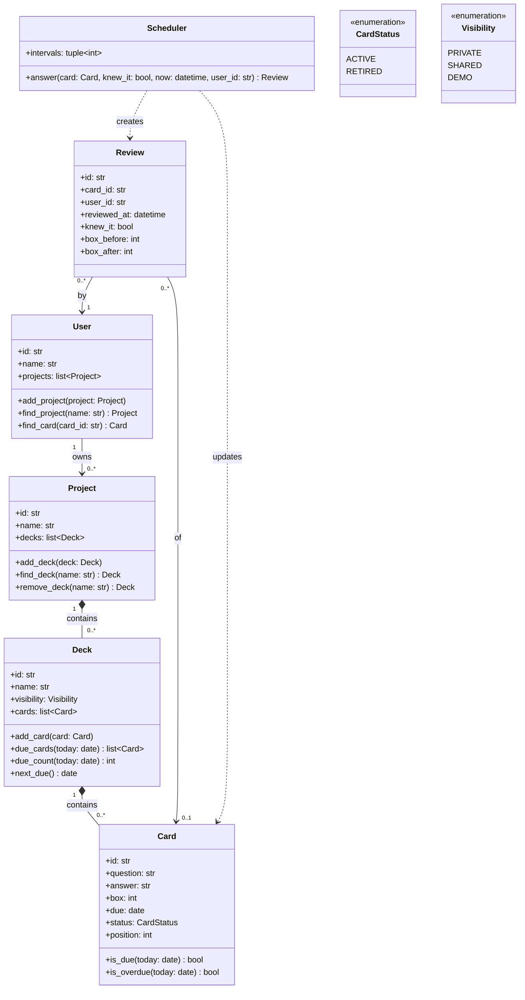

# 4. Domain model

The classes of the Leitbox core: their data, methods and relationships. Domain only: no files,
database or user interface (N8). Package `domain/` in the [architecture](05-architecture.md).

## Explanation

**Ownership.** User → projects → decks → cards. Each deck belongs to one project, each card to
one deck (R13). Composition (filled diamond): deleting a deck deletes its cards (R17).
In the MVP there's one default user, but every project already has an owner, so accounts can be
added later without changing the model.

**Names.** Project and deck names can't be empty and must be unique (per user / per project),
ignoring case and spaces at the ends (D-006, D-009). `find_project`, `find_deck` and
`remove_deck` compare names the same way and raise an error if nothing matches.
`User.find_card` finds a card by ID across all projects and decks (D-010).

**Card.** Question, answer, box (1–5), due date and status. A retired card keeps `box = 5`.
`position` is the card's row in the imported file, the last tie-breaker in the study order (R8).
`is_due(today)`: active and due today or earlier (R10). `is_overdue(today)`: active and due
before today (AC-04.6).

**Deck.** `due_cards(today)` returns the due cards in study order: oldest due date, lower box,
position (R7, R8). `due_count` counts them. `next_due()` is the earliest due date of the active
cards, or `None` if all are retired (AC-04.5). `visibility` is always private in the MVP (R14).

**Scheduler.** Applies the Leitner rules (R3–R6) with the intervals from the config (one per
box). `answer` moves the card (or retires it), sets the due date from `now.date()` and returns
a `Review` stamped with `now`.

**Review.** One answer (R12): when, the result, box before and after. Reviews are kept when
their card is deleted (R18), so they store `card_id` and `user_id` as plain IDs, and a review
points to `0..1` cards.

**After the MVP:** renaming, `Deck.copy_to(project)` and sharing (R14, R15), editing single
cards (US-12), resetting a deck (US-11), deleting a project (US-13), a timezone on `User` (N2).

`today` and `now` are always passed in, never read from the clock inside the core.
