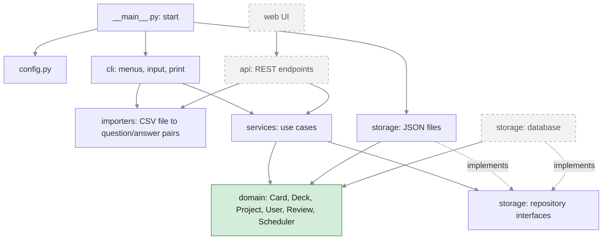

# 5. Architecture

How the code is split into layers, and which layer may use which. Arrows mean "imports /
calls". Grey dashed parts come after the MVP.



## Layers

| Layer | Package | Job | May import |
|---|---|---|---|
| **Domain** (core) | `domain/` | The entities and the Leitner rules ([domain model](04-class-diagram.md)). Pure Python: no files, no `print`/`input`, no database, no web. | nothing from the other layers |
| **Services** | `services/` | The use cases: create a project, import a deck from question/answer pairs, list due cards, answer a card (apply the rules, record the review, save), delete a deck. They coordinate domain and storage, without any input/output of their own. | `domain`, `storage` (interfaces only) |
| **Storage** | `storage/` | Saving and loading projects, decks, cards and reviews. A repository *interface* says what can be done (`save`, `get`, `list`…); the JSON implementation does it with files in `DATA_DIR`. A database implementation replaces it after the MVP. | `domain` |
| **Importers** | `importers/` | Reading a CSV file into question/answer pairs, with its checks (file size, columns, empty fields). Knows nothing about decks or cards. | nothing from the other layers |
| **CLI** | `cli/` | The conversation with the learner: menus, showing questions, asking "knew it?". Calls the services; reads files through the importers. | `services`, `importers` |
| **Start** | `__main__.py` | Assembles the app (`python -m leitbox`): reads `config.py`, creates the JSON storage and the `Scheduler` with the configured intervals, and starts the CLI. | everything it needs to assemble |

**The dependency rule:** arrows point towards the domain, never away from it. So the
domain can be tested without files, and the CLI can be joined by an API without changing the
domain or the services.

**Configuration** (`config.py`) is read only at the start. Its values are passed in, e.g.
the intervals into the `Scheduler`, so no other layer depends on where they come from.

## How the later phases fit in

- **Phase 2 (API):** a new `api/` package calls the *same* services. The database storage is
  a second implementation of the same repository interfaces; the start code decides which one
  is used.
- **Phase 4 (web UI):** the web UI talks to the API only, never to the services or the
  domain directly.
- Nothing in `domain/` or `services/` has to be rewritten for either.

## Folder structure (MVP)

```text
src/leitbox/
├── __init__.py
├── __main__.py     # start: assembles the app, runs the CLI
├── config.py       # settings from the environment + Leitner intervals
├── domain/         # Card, Deck, Project, User, Review, Scheduler
├── services/       # use cases
├── storage/        # repository interfaces + JSON implementation
├── importers/      # CSV → question/answer pairs
└── cli/            # menus, input/output
```
`api/` is added in Phase 2. Tests live in `tests/`, outside the package.
