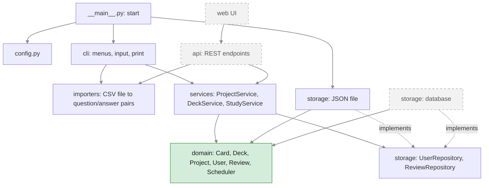

# 5. Architecture

The layers and which layer may use which. Arrows mean "imports / calls". Grey dashed parts come
after the MVP.



## Layers

| Layer | Package | Job | May import |
|---|---|---|---|
| **Domain** | `domain/` | Entities and Leitner rules ([domain model](04-class-diagram.md)). No files, no `print`/`input`, no database. | nothing |
| **Services** | `services/` | Use cases. `ProjectService`: create and list projects. `DeckService`: import and delete decks. `StudyService`: due cards, next due date, answer a card (rules → save review → save user, D-010). | `domain`, `storage` interfaces |
| **Storage** | `storage/` | Interfaces `UserRepository` (`get`, `save`) and `ReviewRepository` (`add`, `list_for_user`). The JSON versions share one file in `DATA_DIR` and write it safely (temp file + replace, D-005, D-010). Converters to and from JSON. | `domain` |
| **Importers** | `importers/` | CSV file → question/answer pairs, with checks (D-008). | nothing |
| **CLI** | `cli/` | Menu, one function per option. Calls the services and the importer. | `services`, `importers` |
| **Start** | `__main__.py` | Creates the repositories, the default user (D-007), the `Scheduler` and the services, then runs the CLI. Turns Ctrl+C/Ctrl+D and a damaged data file into short messages (N4). | everything |

**Dependency rule:** arrows point towards the domain, never away from it. The domain is tested
without files, and an API can be added next to the CLI without changing domain or services.

**Configuration** (`config.py`) is read only at the start; its values are passed in (e.g. the
intervals into the `Scheduler`).

## Later phases

- **Phase 2 (API):** `api/` calls the same services. A database is a second implementation of
  the same repository interfaces; `__main__` (or the API start) chooses which.
- **Phase 4 (web UI):** talks to the API only.
- `domain/` and `services/` stay as they are.

## Folder structure

```text
src/leitbox/
├── __main__.py     # start: assembles the app, runs the CLI
├── config.py       # settings from the environment + Leitner intervals
├── domain/         # Card, Deck, Project, User, Review, Scheduler
├── services/       # ProjectService, DeckService, StudyService
├── storage/        # repository interfaces, JSON implementation, converters
├── importers/      # CSV → question/answer pairs
└── cli/            # menu
```
Tests are in `tests/`, outside the package.
